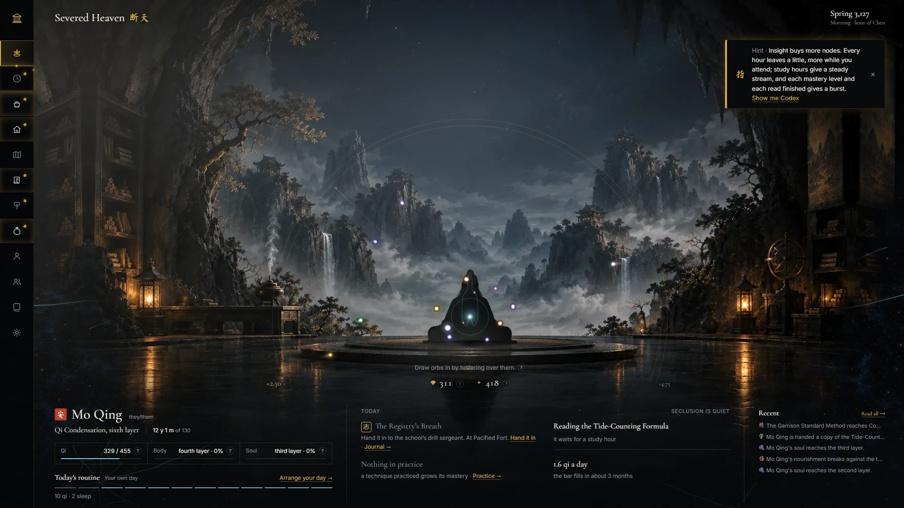
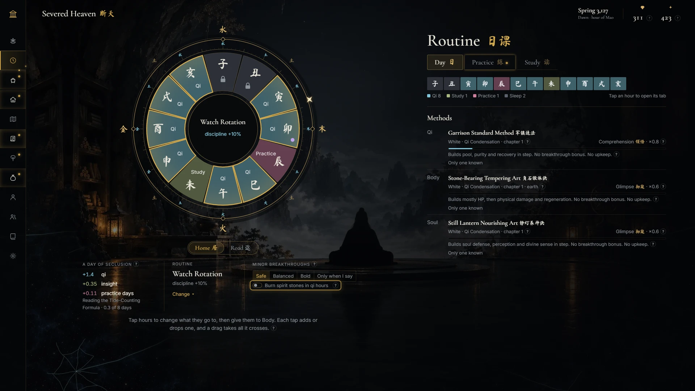
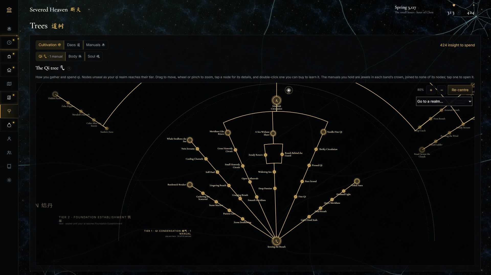
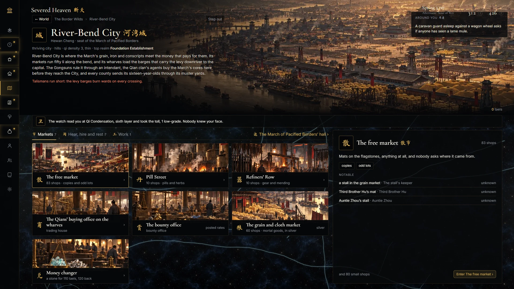
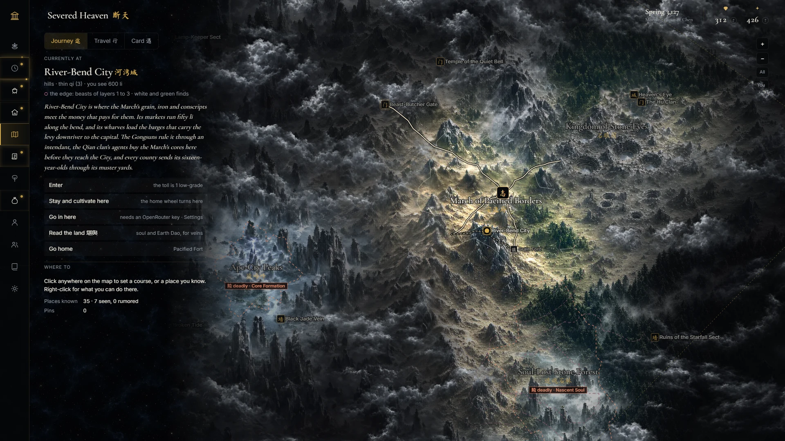
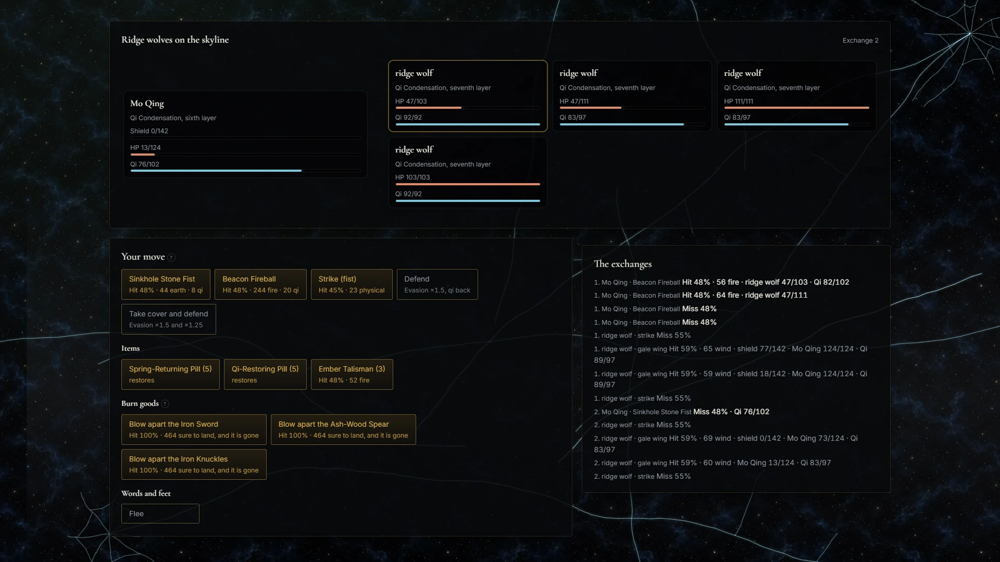
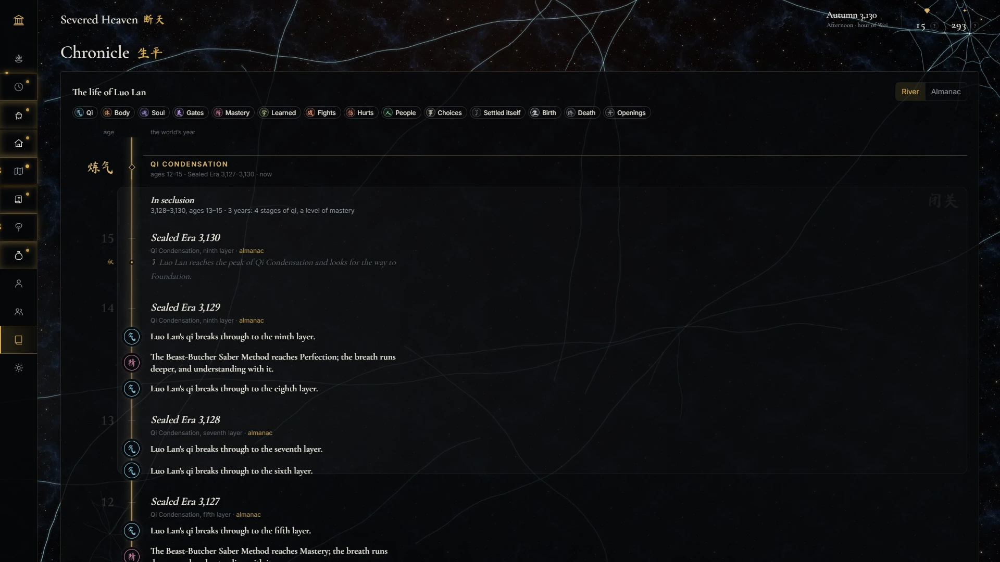

# Severed Heaven 断天

A xianxia cultivation idle game. You are twelve on root-testing day in a broken world, and you climb from there: sit in seclusion, plan your day hour by hour, learn from the trees, walk the painted map, fight what you meet, step into scenes a narrator plays out with you, and read your life back as a chronicle. "Severed Heaven" is the working title until the game has a name.

**Play it:** https://janperolino.github.io/cultivationgame/

It runs in the browser on a computer. There is no account and no server.



## What you can do now

**Cultivate and break through.** Take up the method your origin hands you and sit. Qi fills the bar on its own, and faster while you watch: pass the pointer through the orbs that drift in to draw them. Each full bar is a minor breakthrough up Qi Condensation's nine layers, and the gate to Foundation wants its pill, its offerings and a good grade. Body and soul climb their own ladders once you find an art for each.

**Plan your day.** The Routine screen is a wheel of twelve double hours. Give each to qi, body, soul, study, practice, sleep, your post or your craft. Learned routines pay a little extra for keeping to the hour, and on the road the wheel turns to travel, looking, gathering and standing guard.



**Grow the trees and read manuals.** Insight buys nodes on the Qi, Body and Soul trees, fanned out by realm, with the combat and craft Daos beside them. Copies of manuals go on the bookcase and get read in study hours. A finished manual sits on its tree as a jewel.



**Craft and trade.** Alchemy, refining, talismans, formations and spirit farming each have their own bench, and you sit at the furnace or the forge yourself to lift a batch. Cities and towns have free markets, pill streets, refiners' rows, trading houses, black markets, bounty offices and a money changer. You can haggle once a visit, take commissions, rent or claim a dwelling, and join a sect or a dynasty's garrison.



**Walk the map.** The Border Wilds are painted whole. Click to set a course and the clock carries you there, with fog lifting as you go. Encounters rise on the road as seals: beasts, cultivators, mortals, omens and strange places. Your stance (avoid, careful, bold) settles the easy ones and stops you for the rest.



**Fight.** A fight you choose is played turn by turn: techniques priced against the foe, items, talismans, gear blown apart for one sure blow, and words and feet when it goes badly. The realm gap is real. A layer or two above you is a hard fight. A whole realm above you, run.



**Go in.** At any encounter, any place or any door, Go in opens a scene the narrator writes as you play it (GLM 5.2, through OpenRouter). Type what you do or say. Plain talk stays talk, and the game's rules only step in when you reach for something: a bribe, a theft, a blow. A fight inside a scene plays out on the scene's own painting. What happened stays in the people's memories and in your chronicle.

**People and the chronicle.** Everyone you meet keeps a page: their nature, what they want, how much they trust you and what they remember of you. The powers that know you are listed with your name's reach. The Chronicle is your life as a river: years, seasons and realm chapters, with earlier lives a click away.



## What's coming

- **The world book:** what everyone in the world knows, for the scenes you go into.
- **People and ties:** a cast that lives its own life, courting and dao companions, sworn siblings, masters and disciples, gifts and letters.
- **Guild trade:** guilds trading between markets, caravans, the black market's raids, auctions, beast taming.
- **Core Formation:** the realm past Foundation.
- **The living world:** sect wars, rumors and headlines, places that change, founding your own power.
- **Big moments:** Nascent Soul and the heavenly tribulations.
- **Rebirth and friends:** the next life, and playing alongside each other.

## Good to know

- **Monitors only.** The game is laid out on a 1920×1080 stage that scales to your window. Phones and tablets aren't supported. F11 or Settings › Fullscreen gives it the whole screen.
- **Time runs while you're away.** Up to 12 hours of offline time counts, and a story card tells you what happened. At Qi Condensation one real hour is one year of your life.
- **Going in needs an OpenRouter key.** Make one at [openrouter.ai](https://openrouter.ai), add a little credit, and paste it into Settings › Going in › OpenRouter key. It stays in your browser and never goes in a save or an export. The same panel shows what your calls have cost. Without a key everything else works and the road runs on the engine.
- **Saves live in your browser.** Each slot autosaves. Export from Settings now and then: it's the only way to move a life to another computer, and some browsers clear sites you haven't visited in a while.
- **Ironman or gentle.** Ironman never rewinds. Gentle gives you one rewind to your latest breakthrough, refilled at each major one.
- **Make it yours.** Settings has text size, reduced motion, colors, the glass and sound. A slower clock is there once you reach Foundation.
- **Feedback is welcome.** Tell Jan what felt slow, confusing or great.

## For the curious

Built with TypeScript, React and Vite. To run it locally you need Node 20 or newer:

```bash
npm install
npm run dev
```

`npm test`, `npm run lint` and `npm run build` check everything; `npm run sim -- pacing` prints the pacing tables. Adding `?speed=20` to the URL runs the clock twenty times faster, and in a dev build the `` ` `` key opens the dev console.

- [docs/features.md](docs/features.md): every feature a player can touch, where it lives and how it's taught.
- [docs/design.md](docs/design.md): the rules.
- [plan.md](plan.md): the build plan, what's done and what's next.
- `content/atlas/entries.json`: the world, one entry per place, power, era and race.
